# Match Studio F.3 — dış gözle sert ürün incelemesi

22 Ekim 2026 · https://match-studio-telefon.vercel.app/ · 360×780 mobil Chromium

**Hüküm:** Özellik birikimi güçlü, kullanım düzeni zayıf. Bu sürümü, sahada hızlı ve güvenilir günlük kullanım için geniş kitleye önermem. Kullanıcıya en çok gereken işlemler gizlenirken sloganlar, açıklamalar ve iç sistem kavramları öne çıkarılmış. Üç somut doğruluk/koruma sorunu ve bir klavye odağı hatası gözlendi.

Bu değerlendirme mevcut yayında yeni, yalıtılmış bir tarayıcı oturumu ve sentetik Kıyı Spor kulübüyle yapıldı. Uygulama kodu ve yayın değiştirilmedi. Kullanıcının gerçek kayıtlarına erişilmedi. Önceki otomatik testlerin geçmesi, bu yeni gözlenen senaryoların kapsandığını göstermiyor.

## Öncelikli bulgular

### P1 — Taslak kaybı

**Kanıt:** Sekme değişimi girilmiş maç alanlarını uyarısız siliyor.

**Öneri:** Önce taslakları koru; ayrılma uyarısı veya otomatik taslak kaydı ekle. Geri gelince aynen devam edilebilmeli.

### P1 — Yanlış afiş bilgisi

**Kanıt:** Hazırlık maçı afişte lig maçı olarak adlandırılıyor.

**Öneri:** Tüm afiş başlıklarını maç türünden üret; her tür için çıktı içeriğini doğrula. Genel bir metin, yanlış bir resmî sınıflandırmadan daha güvenlidir.

### P1 — Canlı/rapor süreleri ayrışıyor

**Kanıt:** Kronometre ilerlerken özet ve oyuncu tablosu eski süreyi gösteriyor.

**Öneri:** Aynı zaman izdüşümünü kullan; PDF/rapor üretiminde de güncel anı hesapla veya görünür snapshot zamanı belirt.

### P1 — Modal odağı arka plana kaçıyor

**Kanıt:** Oyuncu ekleme açıkken Tab arka plandaki düğmeye gidiyor.

**Öneri:** Odağı açılan modalın içine taşı; kapatılana kadar içeride tut, kapanınca tetikleyiciye döndür.

### P2 — İlk kurulumun sırası yanlış

**Kanıt:** Maç oluşturma öne çıkarılıyor; grup kurma ayarlar içinde saklı.

**Öneri:** Kulüp → grup/takım → oyuncu → ilk maç sıralı başlangıcı kur. Boş zorunlu seçicinin yanında grup ekleme olsun.

### P2 — Canlı operasyon çok uzun

**Kanıt:** Gol/kart kontrolü sayfanın üçüncü ekranına itilmiş.

**Öneri:** Saat/skor ve Gol, Kart, Değişiklik eylemlerini tek operasyon görünümünde tut; rapor ve düzeltmeleri ayır.

### P2 — Görsel gösteri işin önüne geçiyor

**Kanıt:** Slogan, sürüm, kulüp seçici ve tekrarlı metrikler mobil alanı tüketiyor.

**Öneri:** Ana ekranda sıradaki iş ve yaklaşan maç; saha ekranında saha öncelikli olsun. Tek ana görev, daha az başlık ve kart kullan.

### P2 — Teknik dil ve bakım işleri karışıyor

**Kanıt:** JSON, origin, veritabanı, AES-GCM, oturum, PAKET E, OTHER gibi ifadeler kullanıcıya çıkıyor.

**Öneri:** Ana dili antrenörün görevlerine göre yaz. Teknik ayrıntıları gelişmiş yardımda, taşıma ve tehlikeli işlemleri ayrı bölümde tut.

## Adım adım kanıtlar

### 1. İlk açılış ve kulüp kurulumu — Zayıf

360×780 görünümde büyük slogan ve logo, başlangıç düğmesini ilk ekranın altına itiyor. Yeni kullanıcıdan ilk anda kulüp rengi seçmesi isteniyor; henüz asıl değer gösterilmedi. Eski Darıca Gücü V2.4 taşıma metni her yeni kulübe gösteriliyor.

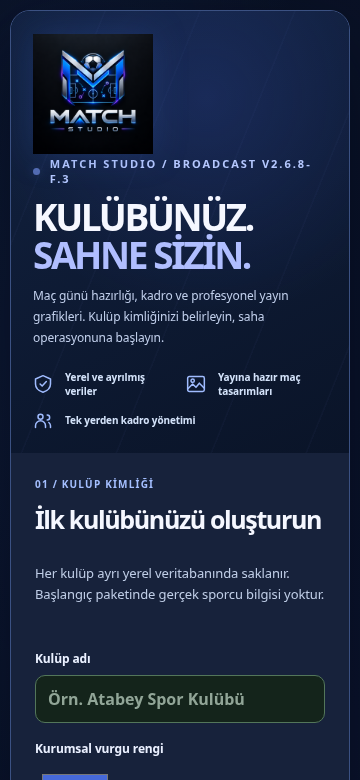

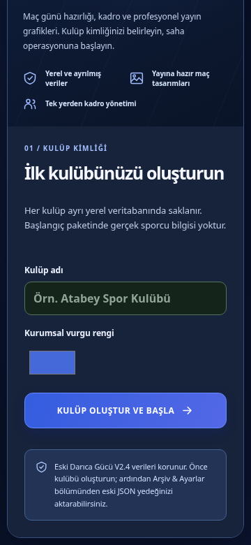

### 2. Kontrol merkezi — Zayıf

Kulüp oluşturulduktan sonra önceki kaydırma konumu korundu; ana ekran başlığı kesilmiş konumda açıldı. Dört yeni maç çağrısı var. Sloganlar ve boş karşılaşma dekoru, ilk gerekli iş olan grup oluşturmayı aşağıya itiyor.

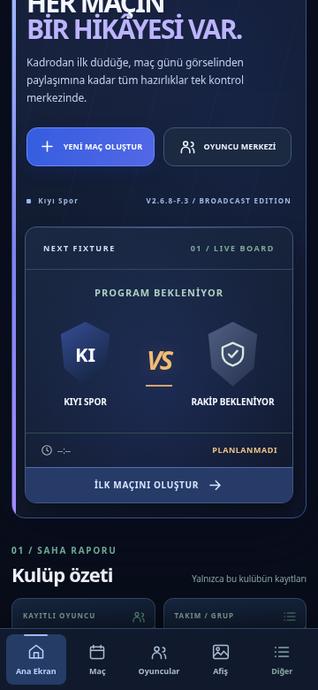

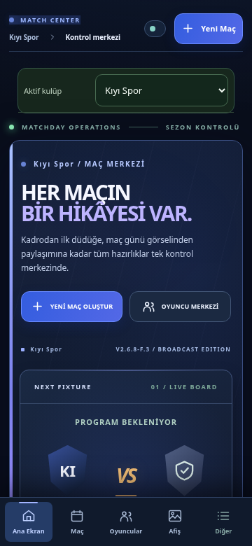

### 3. İlk maç girişimi — Akış tıkanıyor

Zorunlu Takım / Grup seçicisinde hiçbir grup yok. Bu ekranda grup oluşturma eylemi yok. Ana ekranın güçlü çağrısı kullanıcıyı tamamlayamayacağı bir forma getiriyor.

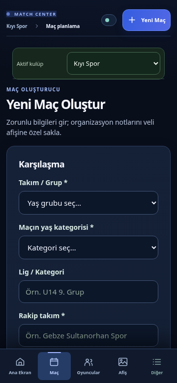

### 4. Oyuncu merkezi — Orta

Oyuncu ekleme bulunabilir, arama etiketli. Fakat sıfır kayıtta Bu filtrede oyuncu yok mesajı yanıltıcı; iki ekleme çağrısı ve CSV terimi boş ekranı gereksiz büyütüyor.

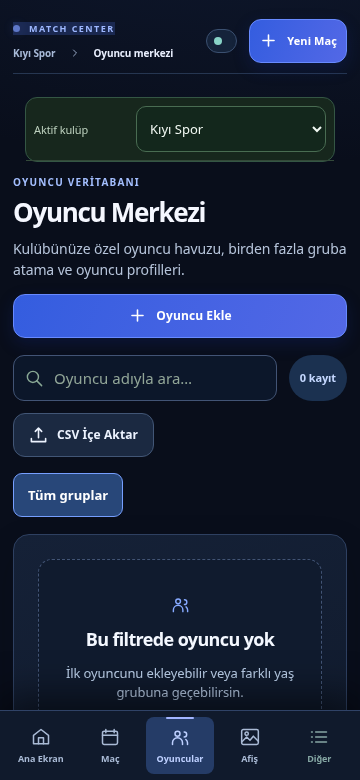

### 5. Mobil gezinme — Zayıf

Canlı maç, kadro ve saha Diğer menüsünde; afiş ana menüde. Saha operasyonu önceliği bakımından seçim tartışmalı. Mobil menüdeki dokunma alanları ve etiketler genel olarak okunabilir.

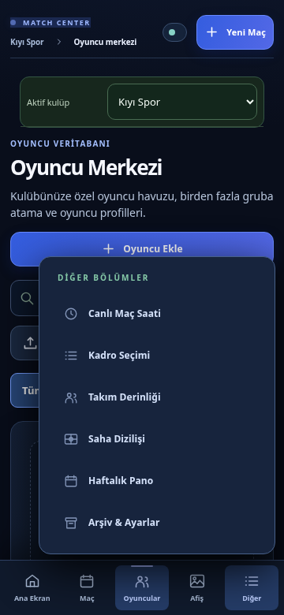

### 6. Grup oluşturma ve ayarlar — Zayıf

Yaş grubu oluşturma alanı Arşiv & Ayarlar içinde yaklaşık 2801 px aşağıda. Önce eski veritabanı taşıma, kulüp silme, yedek ve kurtarma anlatılıyor. İlk gün gerekli bir işlem bakım işlerinin sonuna saklanmış.

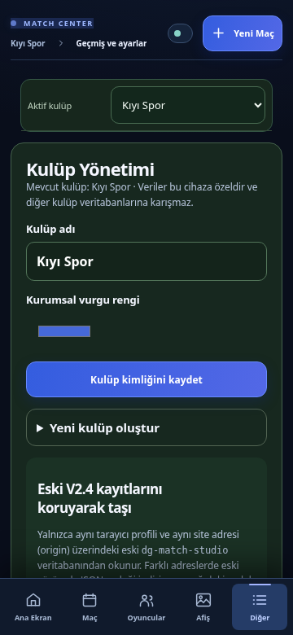

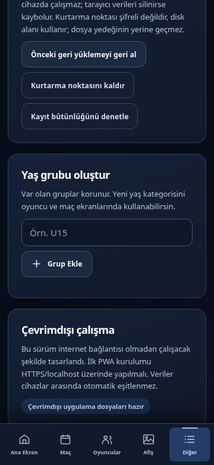

### 7. Oyuncu formu ve klavye odağı — Önemli erişilebilirlik hatası

Doğum yılı ve tarihini birlikte sunmak, başlangıçta lisans ve durum gibi alanları açmak formu uzatıyor. Daha önemlisi: modal açıkken Tab odağı arka plandaki Oyuncu Ekle düğmesine geçti; odak modal içinde tutulmuyor. Form alanlarının erişilebilir adları mevcut.

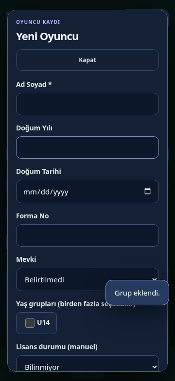

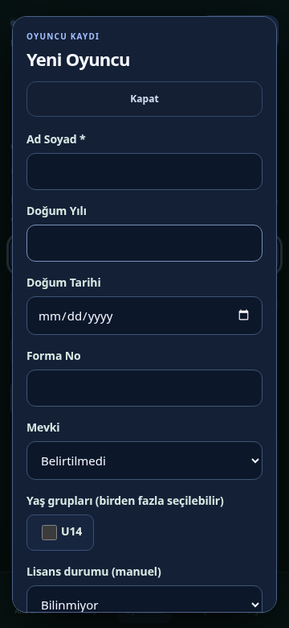

### 8. Kaydedilmemiş maç taslağı — Kritik kullanım hatası

Rakip=Sahil Spor, saha=Kent Stadı, tarih=2026-10-24, saat=14:00 girildi. Oyuncular sekmesine geçilip Maç sekmesine dönüldü. Alanlar boşaldı; hiçbir onay/uyarı çıkmadı. Kaydedilmemiş emek sessizce kayboluyor. Bu bulgu kaydedilmiş maçların silindiği iddiası değildir.

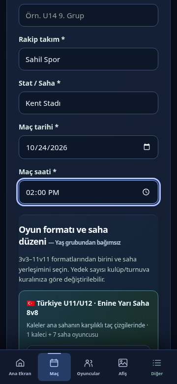

### 9. Kadro seçimi — Zayıf

Başlık, kulüp seçici, beş aşamalı gezinti ve metrikler ilk ekranı dolduruyor; oyuncular aşağıda. Otomatik ilk kadro doldurma işe yarıyor fakat oyuncu seçme işinin önüne gereksiz açıklama ve göstergeler konmuş.

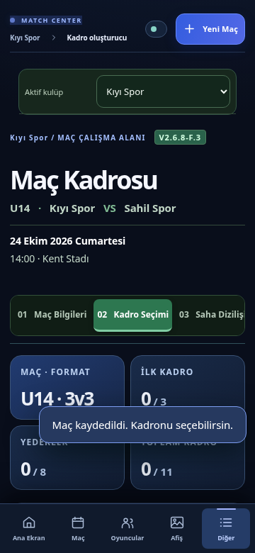

### 10. Saha dizilişi — Zayıf mobil öncelik

Saha ekranının ilk görünümünde saha yok. İlk oyuncu düğmesi yaklaşık 1359 px aşağıda. Üstte aynı maç/gezinti bilgileri tekrar ediliyor. Yedek kartında OTHER kodu görünüyor. Oyuncu adı/forma numarası ve konum düğmeleri ise anlaşılır bir temel sağlıyor.

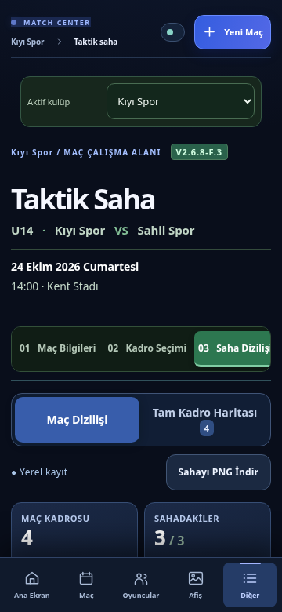

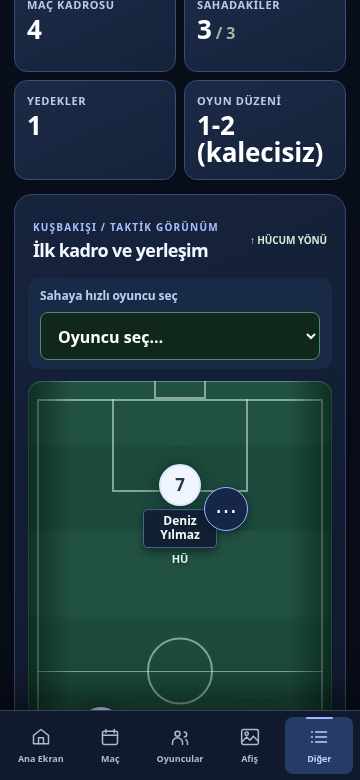

### 11. Canlı maç hazırlığı — Gereksiz teknik dil

Canlı oturum oluştur ve 25,25 biçiminde devre girişi, kullanıcıya iç sistemin kavramlarını anlatıyor. Hazırlama ve başlatmanın ayrı olması yanlış başlatmayı önleyebilir; bunun daha sade anlatılması gerekiyor.

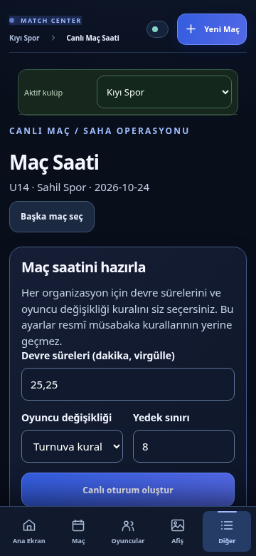

### 12. Canlı maç operasyonu ve özet — Kritik tutarlılık ve hız sorunları

Sayfa yaklaşık 4349 px; gol/kart formu yaklaşık 2504 px aşağıda. Saat, saha, iki farklı oyuncu değişim arayüzü, gol/kart, rapor ve saat düzeltmesi aynı sayfaya yığılmış. Canlı toplam 01:02 iken özet ve oyuncu süreleri 00:00 kaldı. Saat büyük ve okunur; buna rağmen operasyon ekranı hızlı müdahaleyi desteklemiyor.

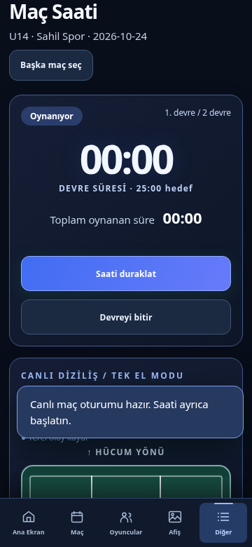

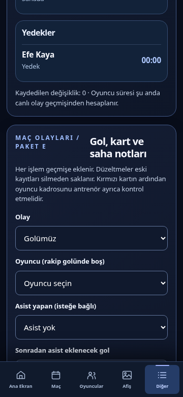

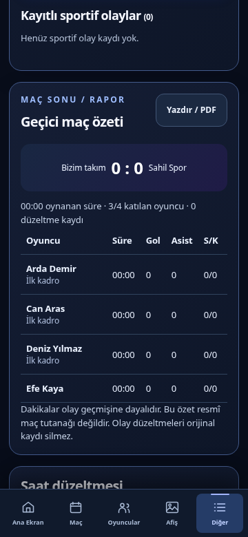

### 13. Afiş editörü ve önizleme — Gezinti kalabalık

Beş aşamalı maç gezintisi, dört stüdyo sekmesi ve uygulama alt menüsü üst üste. İlk görünümde önizleme sekmesinde bile afiş büyük ölçüde aşağıda. Kalıcı indirme/paylaşım alanı olumlu. Mobil önizlemede küçük metinleri denetlemek zor.

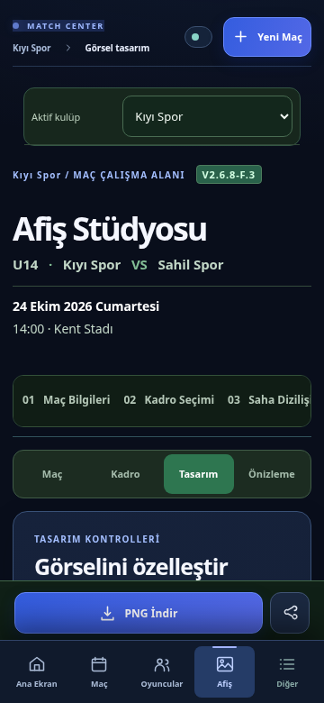

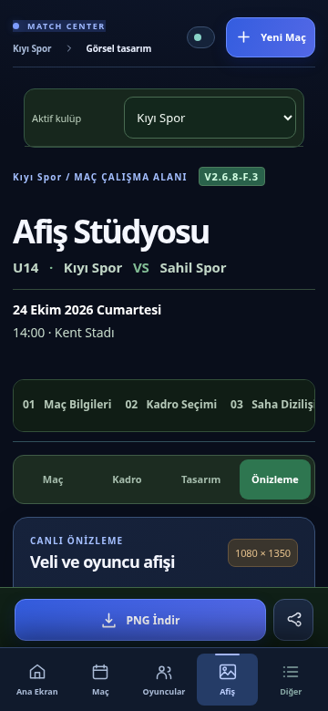

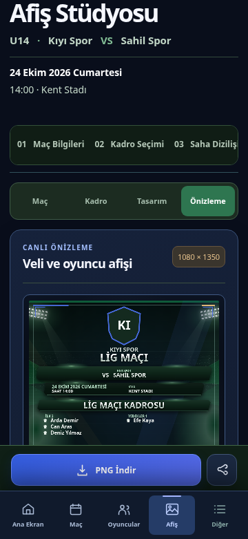

### 14. PNG çıktısı ve kaynakla karşılaştırma — Kritik içerik hatası

PNG üretildi ve indirildi; isim, tarih ve saat okunuyor. Ancak kaydedilmiş müsabaka türü friendly/Hazırlık, lig alanı boş olmasına rağmen çıktı LİG MAÇI ve LİG MAÇI KADROSU diyor. Az oyunculu içerikte alt yarıda büyük boşluk var; varsayılan şablon içeriğe uyarlanmıyor.

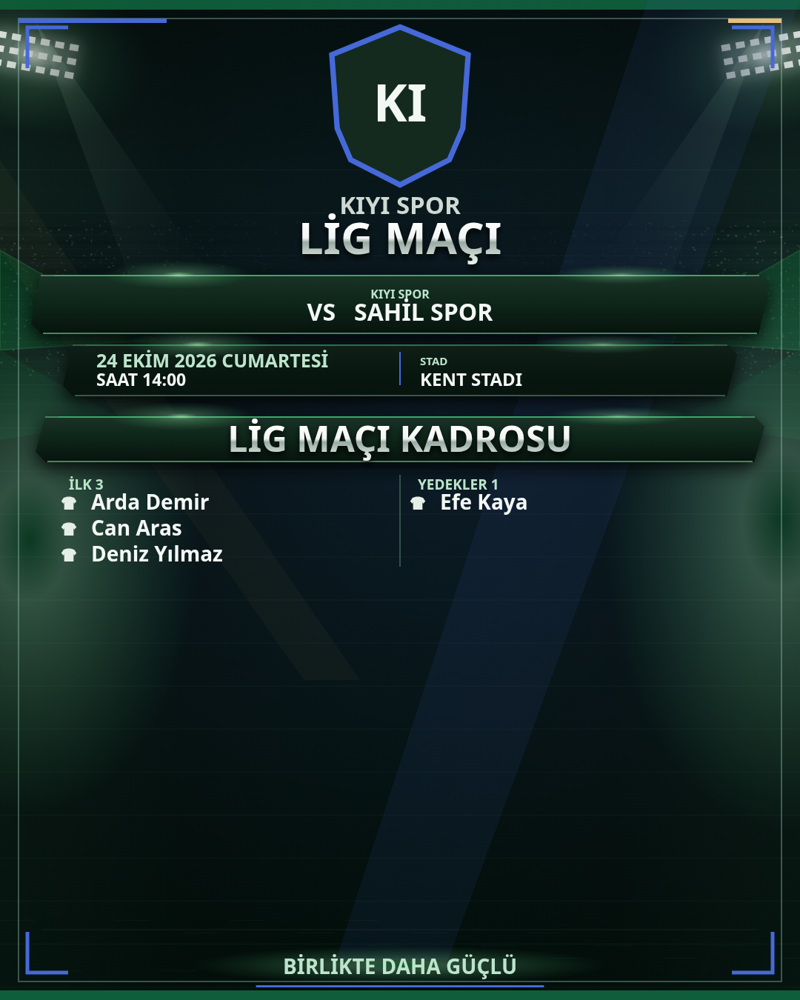

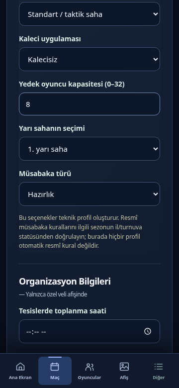

## İşe yarayan çekirdek

Kulüp, oyuncu, maç, kadro ve afiş arasında kullanılabilir bir veri zinciri var. Oyuncu seçme ve ilk kadro doldurma çalıştı. Saat büyük ve okunur. PNG başarıyla indirildi; isim, tarih ve saat okunuyor. Form alanlarının çoğunun erişilebilir adları mevcut. Bu gözlemler, yukarıdaki tutarlılık ve akış kusurlarını ortadan kaldırmıyor.

## Önce ne yapılmalı?

1. Taslak kaybı, afiş başlığı, canlı özet ve modal odağını düzelt; aynı adımları yeniden dene.
2. İlk kurulum ve maç oluşturmayı tek bir görev zincirine indir. Maç formunda yaklaşık 20 alanı tek seferde gösterme; gerekli bilgiler ve isteğe bağlı organizasyonu ayır.
3. Canlı kullanım için saat/skor ve üç ana eylemi öne al. Rapor, bakım ve düzeltme başka görünümde olsun.
4. Tek bir görsel sistem ve Türkçe görev dili kullan; yeni şablon veya yeni modülden önce mevcut işlerin yükünü azalt.
5. Yeni kullanıcılarla ilk maçını hazırlama ve maç sırasında gol/değişiklik kaydetme görevlerini gözle. Bu oturum gerçek kullanıcı araştırmasının yerine geçmez.

## Sınırlar

Bu bir ürün/UX ve sınırlı klavye erişilebilirliği incelemesidir. Gerçek Z Fold donanımı, ekran katlama, Türkçe Android klavyesi, güneş altında okunabilirlik, ekran okuyucu, sayısal WCAG kontrastı, tam güvenlik ve uzun süreli saha kullanımı test edilmedi. Yerel tarayıcı dili nedeniyle tarih/saat girişinin görünümü gerçek cihazdaki görünümle aynı olmayabilir. Çevrimdışı çalışma ve şifreli yedek geri yükleme bu turda yeniden sınanmadı; yedekleme bölümünün bulunabilirliği ve anlatımı incelendi. Bu oturumda işlenmemiş JavaScript hatası görülmemesi, bütün ürünün hatasız olduğu anlamına gelmez.
